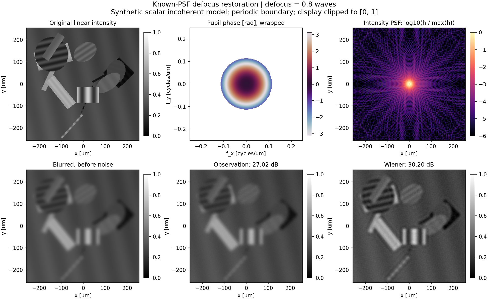
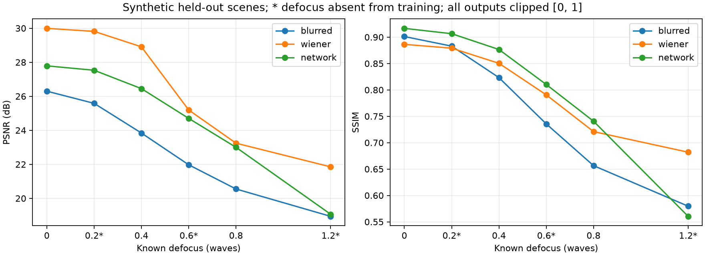

# 基于光学成像模型的离焦图像复原

面向光电专业大二的计算成像入门项目。沿着“光瞳 → 点扩散函数 PSF → 模糊观测 → 图像复原”完成一个可运行、可解释、可复核的实验，再接入 PyTorch 小型条件 U-Net。

第一版已经在本机运行：Python 光学仿真与维纳复原、独立测试集、12 轮 CUDA 网络训练和重载评估、MATLAB 对照。真实记录见 [验证记录](docs/validation.md)。

## 先跑第一张图

在 PowerShell 中执行：

```powershell
cd D:\dl-cv-intro\defocus_restoration
python demo.py
```

打开 `outputs/demo/comparison.png`，依次看原始强度、光瞳相位、PSF、无噪模糊图、含噪观测和维纳复原。默认例子 PSNR 从 **27.02 dB 提高到 30.20 dB**。这些分数来自程序生成的教学图像。



也可以运行 `.\run_demo.ps1`。本机默认 Python 已有传统部分依赖；换电脑后按需安装：

```powershell
python -m pip install -r requirements.txt
```

默认例子参数：256×256、波长 550 nm、像素间距 2 μm、F/8、离焦 0.8 waves、高斯噪声标准差 0.005、维纳正则参数 0.01。`--help` 可以查看完整参数。

## 你可以立即做的三个实验

每次固定其余条件，只改变一个量，使用不同目录保留结果：

```powershell
python demo.py --defocus 0 --output outputs/focus
python demo.py --defocus 1.2 --output outputs/defocus12
python demo.py --balance 0.001 --output outputs/small-balance
```

先解释为什么离焦为零仍有衍射模糊，再比较较小正则参数是否放大噪声。实验步骤和课程联系见 [学习路线](docs/learning-path.md)。

提供自己的清晰图片可以生成它对应的合成模糊与复原：

```powershell
python demo.py --image "D:\你的图片\clear.png" --output outputs/my-image
```

此入口把图片当作清晰物体，随后模拟离焦。真实拍摄的模糊照片还需要标定 PSF 和成像条件。普通图片按 sRGB 解码后转线性亮度、居中裁剪和缩放；没有做相机 RAW 标定或 ICC 色彩管理。

## 做一次规范比较

```powershell
python experiment.py
```

脚本在独立的 6 张验证底图、3 种离焦上，从 `1e-5, 1e-4, 0.001, 0.01` 中选择一个全局维纳参数，然后冻结该值，在 8 张测试底图、7 种离焦上评价。本次选择 `0.01`。

查看 `outputs/baseline/defocus_curve.png`、`validation.csv`、`test_metrics.csv`、`summary.json` 和 `manifest.json`。底图先按来源划分，再生成模糊版本，避免同一原图同时出现在训练和测试中。

## 接入深度学习

本机可用环境为 `D:\Anaconda3\envs\cv_pytorch\python.exe`，已实际通过 RTX 5060 Laptop GPU 的 CUDA 卷积和反向传播验证。默认 `python` 环境没有 PyTorch；传统部分独立运行。

在项目目录执行：

```powershell
.\run_train.ps1 -Python 'D:\Anaconda3\envs\cv_pytorch\python.exe'
```

它运行 12 轮训练，并自动重载验证集选出的 `best.pt` 评价独立测试集。默认 96 张训练底图、16 张验证底图，均与 `0,0.4,0.8` waves 组合，形成 288/48 个样本。图像尺寸 128×128，batch size 为 8，网络有 29,689 个参数。

测试使用另外 12 张底图和 `0,0.2,0.4,0.6,0.8,1.2` waves，共 72 个观测。`0.2,0.6` 检查未见参数插值，`1.2` 检查外推；所有测试底图均未见。

也可以分别运行：

```powershell
& 'D:\Anaconda3\envs\cv_pytorch\python.exe' train.py --epochs 12 --train-count 96 --val-count 16 --size 128 --device auto
& 'D:\Anaconda3\envs\cv_pytorch\python.exe' evaluate.py --checkpoint outputs/network/best.pt --output outputs/network-evaluation --test-count 12 --device auto
```

换电脑时，在选定环境中安装 `requirements-learning.txt`；CUDA 是否兼容还取决于对应 PyTorch 构建与驱动。`--device auto` 会实际试运行 CUDA，不兼容时提示并回退 CPU；`--device cpu` 可显式选择 CPU。

本次网络在 0.8 waves 测试上的平均 PSNR 是 **23.00 dB**，维纳是 **23.24 dB**；在 1.2 waves 外推时网络为 **19.07 dB**，维纳为 **21.85 dB**。网络在这些条件下 PSNR 仍低于维纳，部分条件下 SSIM 较高，外推时也可能下降。应同时看曲线、图像和失败案例。

训练记录在 `outputs/network/`，网络与传统方法对比在 `outputs/network-evaluation/cross-defocus.png`，逐图指标和原始数组也保留。实现细节见 [网络说明](docs/network-design.md)。



## 用 MATLAB 对照课程

在 MATLAB 中打开并运行 `matlab/lesson1_defocus.m`，只需要 MATLAB 基础功能。输出在 `outputs/matlab/`。本机 R2024a 已运行成功，默认例子 PSNR 从 22.68 dB 提高到 27.19 dB。

MATLAB 与 Python 使用相同光学公式，但演示场景和噪声不同，两组演示分数不能直接相比。保存 MATLAB 结果后，可以核对同一数组的数值一致性：

```powershell
python verify_matlab.py
```

## 先理解这几个约定

- **已知 PSF 的非盲复原**：维纳知道 PSF；网络知道真实离焦参数及固定成像配置。
- **离焦单位是 waves**：表示瞳边缘相对瞳中心的光程差除以波长，没有直接换算成镜头移动毫米数。
- **单色非相干成像**：对强度图做卷积，PSF 来自复振幅点响应的模方。
- **周期边界**：正向成像和逆算子都采用整幅图的圆周卷积，真实照片边界需要另行处理。
- **原始数据不截断**：`.npz`/`.mat` 保存浮点观测与复原；显示和所有方法的 PSNR/SSIM 统一截断到 `[0,1]`。PNG 是展示图。
- **合成教学实验**：尚未验证真实相机、自然图像泛化或科研创新，后续需要标定和独立外部数据。

公式、采样条件、指标口径见 [核心物理说明](docs/core-notes.md)。

## 文件入口

- `demo.py`：第一张六图对比；`experiment.py`：验证选参和离焦曲线。
- `defocuslab/optics.py`、`restoration.py`：光学正向模型与维纳复原。
- `defocuslab/data.py`、`metrics.py`：数据来源、分区和指标。
- `defocuslab/model.py`、`learning.py`、`train.py`、`evaluate.py`：可选网络扩展。
- `matlab/lesson1_defocus.m`、`verify_matlab.py`：MATLAB 课程实验与数值对照。
- `docs/project-plan.md`：项目边界、老师方向的交叉点及下一步。
- `docs/validation.md`、`docs/review.md`：实际运行记录与海瑞审校。
- `PROJECT_REPORT.md`：最终项目呈报；内阁办理记录可在本地看板查看。

推送到已有 GitHub 仓库的方法见 [GitHub 推送步骤](docs/github-push.md)。

## 运行检查

默认 Python 的物理检查：

```powershell
python -m pytest tests/test_physics.py -q
```

PyTorch 环境的学习检查（使用内置 unittest，无需 pytest）：

```powershell
& 'D:\Anaconda3\envs\cv_pytorch\python.exe' -m unittest discover -s tests -p test_learning.py -v
```

已分别通过 23 项物理检查和 4 项学习检查。若在新环境需要统一使用 pytest，安装 `requirements-dev.txt` 后运行 `python -m pytest tests -q`。

第一步只需运行 `python demo.py`，并能解释六幅图之间的关系。建议每周约四小时，先完成光学和传统复原，再逐步读网络代码。
